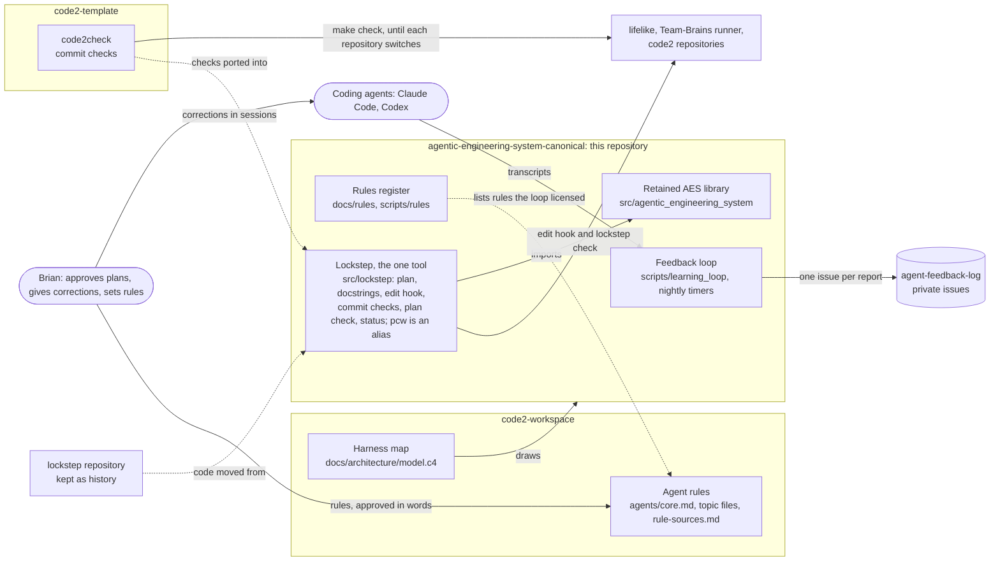
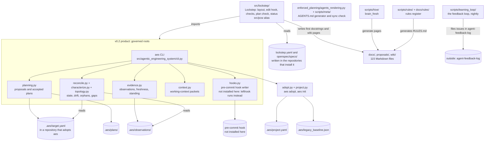

# AES canonical: system model (planning view)

AES is the whole agent system: Lockstep, the feedback loop and the policy layer (Brian, 2026-11-11: "to me aes
is the whole sysem lockstep is one part. aes include the whole feedback and policy system"; `~/.claude/history.jsonl`,
session a769ac09). Its parts live in four repositories (Lockstep moved into this one on 2026-11-11 and 2026-11-12, PRs #831 to #837). This page shows where each part is, what talks to it, and
which part of this repository does what. It extends the checked model of the v0.2 engine, [ODD.md](../model/ODD.md)
and [trace.yaml](../model/trace.yaml). Every code unit is on the [system map](system-map.md). Read at origin/main
`0395758` (2026-11-12).

## Context: AES's parts, where each lives, and what talks to them

Question answered: what is AES made of, which repository holds each part, and what talks to it? This is also the
cross-repository view: this repository, agentic-engineering-system-canonical, is one of four.

Dotted arrows are history (code moved or ported) or partial (the register lists one rule; open question Q20). Users switched
but not all: lifelike is pinned to this repository, code2-template installs lockstep, and Team-Brains' runner vendors its wheel
(`wiki/lockstep.md:21-23`); existing code2 repositories switch when next changed.

## Containers: the parts of this repository

Question answered: which part does what, and which stores does each write?

## Record types the v0.2 code defines, and what writes each

The retained library's records. The `aes` command line that writes them retires one repository at a time
(code2-workspace decision 0009 (a)); Lockstep still imports the library.

| Type | Defined at | Written by | Stored in |
|---|---|---|---|
| `TargetRecord` with `Outcome`, `NormativeItem`, `SuccessCriterion`, `EvidenceRequirement`, `Component`, `PlannedArtifact`, `VerificationSubject`, `ExternalBoundary` | `src/agentic_engineering_system/records.py:137` (members from line 65) | `aes init` (`project.py:166`), `aes plan accept` (`planning.py:646`) | `.aes/target.yaml` |
| `ProjectRecord` with `AesInfo`, `Materialization`, `Ecosystem` | `records.py:194` | `aes init` (`project.py:159`) | `.aes/project.yaml` |
| `Proposal`, `TargetDelta`, `TraceReviewDeclaration` | `planning.py:168`, `:137`, `:148` | the agent, by hand, before `aes plan validate` | a proposal file anywhere |
| `AcceptedPlan` | `planning.py:197` | `aes plan accept` (`planning.py:643`) | `.aes/plans/<id>.yaml` |
| `ObservationRecord` with `Observer`, `ErAssessment`, `DependencyBasis`, `NegativeControl`, `DecisionCheck`, `TraceReview` | `evidence.py:184` (members from line 99) | `aes evidence record` (`evidence.py:613`); external observations by hand in the same shape | `.aes/observations/` |
| `EvidenceReport`, `CriterionStanding`, `ErStatus` | `evidence.py:427-441` | computed by `assess` (`evidence.py:510`), never stored | none |
| `Characterization`, `CharacterizedFile`, `Producer`, `Drift` | `characterize.py:61`, `:54`, `:49`, `:208` | computed by `aes characterize` | none (`--out` writes a copy, `cli.py:286`) |
| `Reconciliation` with `DriftFinding`, `ArtifactState`, `CriterionState`, `ObservationState`, `PlanState`, `Gap`, `ComponentState`, `MissingRequirement` | `reconcile.py:134` (members from line 69) | computed by `aes status` / `aes reconcile` (`reconcile.py:259`) | none |
| `TopologyReport` | `topology.py:38` | computed by `aes topology check` | none |
| `Baseline`, `LegacyState`, `AdoptResult` | `adopt.py:48`, `:67`, `:56` | `aes adopt` (`adopt.py:156`) | `.aes/legacy_baseline.json` |
| `WorkingContext`, `Provenance` | `context.py:72`, `:63` | computed by `aes context <subject>` | none |
| Helper and result types: `Locator` (`records.py:101`), `FamilyEntries`/`FamilyKeys`, `OutsideGovernedRoot` (`planning.py:107-143`), `CharacterizeReport` (`characterize.py:250`), `InitResult` (`project.py:66`) | as listed | computed or nested inside the records above | none |
| `ReviewCheck` | `trace_review.py:18` | computed while assessing a trace-review requirement | none |
| Feedback loop: `Record` with `Link`, `Provenance` (one observation, claim or action line) | `scripts/learning_loop/records.py:49`, `:34`, `:39` (contract at line 25) | `feedback_log.py:94` and `:172`, called by the nightly `collect_feedback.py` | `reports-<date>.jsonl` in `~/projects/data/feedback-collector/` (`collect_feedback.py:69`), filed as agent-feedback-log issues |
| Feedback loop: `Turn`, `Transcript` | `scripts/learning_loop/transcripts.py:42`, `:51` | read from Claude Code and Codex session logs (`collect_feedback.py:127`) | none (read only) |
| Feedback loop: subagent `Check`, `Verification`, `Outcome` | `scripts/learning_loop/subagents.py:30`, `:38`, `:51` | the nightly collector (`collect_feedback.py:66` imports it) | turned into `Record` lines in `reports-<date>.jsonl` |
| Feedback loop: problem analysis `_Step`, `_Fix`, `_Analysis` | `scripts/learning_loop/problems.py:184`, `:191`, `:197` | `problems.py` (model answer schema, `problems.py:246`), reading `reports-*.jsonl` | `problems-<date>.jsonl`; with `--file`, one issue per recurring problem |
| Policy layer: `Disposition` (keep, move or retire for one legacy rule) | `scripts/rules/sort_legacy.py:54` | `sort_legacy.py` (model answer, checked at line 94) | `legacy-sort.jsonl` and `legacy-dispositions.private.yaml` in `~/projects/data/agent-router/` (`sort_legacy.py:11`, `:328`) |

## Lockstep's records

Lockstep (package `src/lockstep/`, specs `openspec/specs/lockstep-*`) keeps no database of its own. It reads the plan from
OpenSpec requirements plus `layout:` rows in `lockstep.yaml` (`src/lockstep/layout_plan.py:29-30`, `:60`, `:101`), still reads
`.aes/target.yaml` (`wiki/lockstep.md:30`), and keeps a side file `lockstep.yaml` with schema `lockstep.side.v1`
(`src/lockstep/side_file.py:126-127`, `SideFile` at `:136`). Its commit checks and their block, warn or off modes come from
`src/lockstep/checks/config.py:23-24` (`Config` at `:33`). Its writes are source and test files that begin with a docstring
copy of the plan (`src/lockstep/scaffold.py`), the append-only change log (`src/lockstep/change_log.py`), generated wiki pages
(`src/lockstep/wiki.py`) and a hook log under `.lockstep/` in the installing repository (`src/lockstep/hook.py:172`, resolved Q23), and, when `lockstep init` runs, the config file and the Claude Code and Codex hook entries it installs (`src/lockstep/init_repo.py`). These live in the repositories that
install Lockstep. AES now also self-adopts source-fact and catalog maintenance:
its root declarations, reviewed inventory and generated document targets are tracked
here; runtime receipts remain ignored under `.lockstep/`. Tests retain separate fixtures.

The source-fact projection slice adds the following persisted records in an installing
repository. The source retains authority; generated blocks carry selected facts and a
source link, not a second editable statement of those facts.

| Record | Fields and relationship | Written by | Stored in / read by |
|---|---|---|---|
| Projection declaration | `id`, repository-relative `source` and `target`, distinct `fields`, optional Python `symbol`; each declaration binds source-owned facts to a named target block. Optional `source_base_url` belongs to the surrounding config. | The repository author or coding agent edits the existing config. | `lockstep.yaml` `projections:`; validated by `src/lockstep/doc_projection.py:declarations`. |
| Source facts and target block | Markdown YAML front matter, Python docstring/signature, or top-level JSON/YAML fields supply selected values; a matching `<!-- lockstep facts: ID -->` block holds the generated copy and source link. | The author edits the source; `project_facts` rewrites only declared target blocks during refresh or `lockstep check project`. `--check` compares without writing. | Source and target paths from the declaration; read by `src/lockstep/doc_projection.py:project_facts`. |
| Projection refresh trace | Success: `tool`, `inputs` (`source`, `fields`, `sha256`, selected `facts`), `outputs` (`target`, `sha256`), `rewrote`, `exit_status`. Failure: `tool`, declared `inputs`, `error`, `exit_status: 2`; unavailable hashes/results are not invented. | `src/lockstep/doc_projection.py:refresh_cli`, called by native PostToolUse entries or the explicit refresh command. | Append-only `.lockstep/projection-YYYY-MM-DD.jsonl`, one UTC file per day in the installing repository. |

An installed hook refreshes declared copies after an applicable edit. The separate
read-only project check is the commit/merge backstop when refresh is bypassed.
The [bounded acceptance table](source-facts-acceptance.md) separates installed
command replay from observed native-client dispatch.

## Does AES execute typed rules?

No. AES's rules (drift, staleness, insufficient-not-green, trace-review declared) are fixed Python
functions such as `assess` (`src/agentic_engineering_system/evidence.py:510`) and `reconcile`
(`reconcile.py:259`). The target holds typed records that reference each other, but no record
defines a rule whose effect AES evaluates, so there is no type-level metamodel to map onto the
shared kernel. Open-questions entry Q9 records the reasoning.

## Outside this model

- The claims, sessions and worktree machinery (`enforced_planning/`, `scripts/meta/`, the claims-era `scripts/*.py`) and
  the v0.1 `repository_context` and the agent router: retired on 2026-11-12 ([record](../retired/2026-11-12.md)); `~/code2`
  replaced claims with `claude -w` worktrees (`~/code2/AGENTS.md`) (Q10 resolved).
- The rules register file `docs/rules/register.yaml` and the feedback loop's plans and pages in
  `proposals/aes-learning-loop/`: their record types are in the table above; the system map names each code unit.
- Lockstep's walkthrough: now built as `proposals/planning-package/review-page/lockstep-acceptance.html` from recorded runs (`scripts/acceptance/`, `docs/planning/runs/lockstep-acceptance/`); A1 to A5 are built, not judged by Brian (Q22 resolved).
- The Company Planning profile files under `docs/architecture/` (ODD.md gap G1).

## Complete-file catalog maintenance (2026-11-14)

The optional `catalog` configuration names an inventory and rendered navigation.
[`catalog.py`](../../src/lockstep/catalog.py) reads Git-index membership and source
bytes without executing repository hooks or file monitors. The existing CLI and
post-edit refresher call it. The records are:

| Record | Fields and purpose | Writer and storage |
| --- | --- | --- |
| Reviewed catalog entry | Repository-relative path, summary, role, disposition, source locator and reviewed sha256; a review reason explicitly explains retained or changed meaning. Self-output hashes are null while coverage includes both outputs. | The active coding agent submits a hash-bound review; `review_catalog` validates it before atomically replacing the configured inventory. |
| Pending review | Added, changed or removed indexed path, its current source hash and prior summary. Hash disagreement detects changed bytes; no mechanical semantic judgment is claimed. | Computed by `inspect_catalog`; delivered in native post-edit context and read-only CLI reports. |
| Generated catalog | Stored summaries, roles, dispositions, source links and visible pending warnings. Generation never approves reviews. | `refresh_catalog` writes the configured Markdown target. |
| Catalog operation receipt | Operation, reviewed paths/hashes/summaries/reasons or generation input identities, intended output hash and failures. A prepared receipt alone is not proof of a completed replacement. | `.lockstep/catalog-YYYY-MM-DD.jsonl`, appended before mutation; actual output hash and CLI result establish application. |

Local checks inspect working files. The pre-commit route inspects index bytes,
allowing unrelated unstaged edits while refusing a stale staged source or review.
The [procedure and observation boundaries](../architecture/DOCUMENTATION.md#ongoing-complete-file-catalog-upkeep)
and [native receipt](../../evidence/runs/catalog-upkeep-native-20261114.json)
state what has actually been exercised. Older rendered planning pages retain
their own dated revision and do not establish current catalog behavior.
