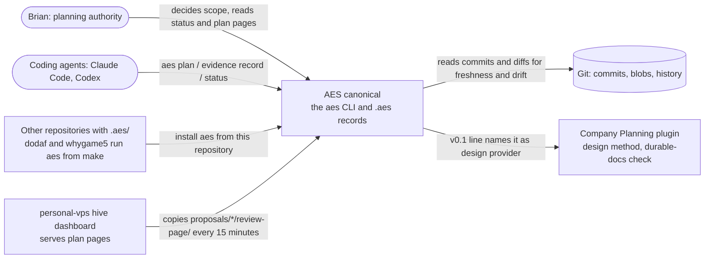
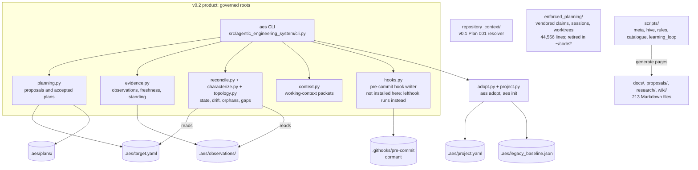

# AES canonical: system model (planning view)

This page extends the checked system model, [ODD.md](../model/ODD.md) and
[trace.yaml](../model/trace.yaml), which cover the v0.2 governance loop's four entities and four
rules. Here: who and what AES talks to, which parts of the repository do what, and every record
type the v0.2 code defines with the module that writes it. Read at origin/main `30e9993`
(2026-10-27). The repository is on hold since 2026-10-18 ([now.md](../../.project-brain/now.md) line 3).

## Context: who uses AES and what it touches

Question answered: what is inside AES and what talks to it?

## Containers: the parts of this repository

Question answered: which part does what, and which stores does each write?

## Record types the v0.2 code defines, and what writes each

| Type | Defined at | Written by | Stored in |
|---|---|---|---|
| `TargetRecord` with `Outcome`, `NormativeItem`, `SuccessCriterion`, `EvidenceRequirement`, `Component`, `PlannedArtifact`, `VerificationSubject`, `ExternalBoundary` | `src/agentic_engineering_system/records.py:137` (members from line 65) | `aes init` (`project.py:166`), `aes plan accept` (`planning.py:646`) | `.aes/target.yaml` |
| `ProjectRecord` with `AesInfo`, `Materialization`, `Ecosystem` | `records.py:194` | `aes init` (`project.py:159`) | `.aes/project.yaml` |
| `Proposal`, `TargetDelta`, `TraceReviewDeclaration` | `planning.py:168`, `:137`, `:148` | the agent, by hand, before `aes plan validate` | a proposal file anywhere |
| `AcceptedPlan` | `planning.py:197` | `aes plan accept` (`planning.py:643`) | `.aes/plans/<id>.yaml` |
| `ObservationRecord` with `Observer`, `ErAssessment`, `DependencyBasis`, `NegativeControl`, `DecisionCheck`, `TraceReview` | `evidence.py:176` (members from line 91) | `aes evidence record` (`evidence.py:613`); external observations by hand in the same shape | `.aes/observations/` |
| `EvidenceReport`, `CriterionStanding`, `ErStatus` | `evidence.py:419-433` | computed by `assess` (`evidence.py:447`), never stored | none |
| `Characterization`, `CharacterizedFile`, `Producer`, `Drift` | `characterize.py:59`, `:52`, `:47`, `:204` | computed by `aes characterize` | none (`--out` writes a copy, `cli.py:286`) |
| `Reconciliation` with `DriftFinding`, `ArtifactState`, `CriterionState`, `ObservationState`, `PlanState`, `Gap`, `ComponentState`, `MissingRequirement` | `reconcile.py:134` (members from line 69) | computed by `aes status` / `aes reconcile` (`reconcile.py:259`) | none |
| `TopologyReport` | `topology.py:38` | computed by `aes topology check` | none |
| `Baseline`, `LegacyState`, `AdoptResult` | `adopt.py:48`, `:67`, `:56` | `aes adopt` (`adopt.py:156`) | `.aes/legacy_baseline.json` |
| `WorkingContext`, `Provenance` | `context.py:72`, `:63` | computed by `aes context <subject>` | none |
| Helper and result types: `Locator` (`records.py:101`), `FamilyEntries`/`FamilyKeys`, `OutsideGovernedRoot` (`planning.py:107-143`), `CharacterizeReport` (`characterize.py:250`), `InitResult` (`project.py:66`) | as listed | computed or nested inside the records above | none |
| `ReviewCheck` | `trace_review.py:18` | computed while assessing a trace-review requirement | none |
| `RepositoryContextArtifact` and its observations (v0.1) | `repository_context/models.py:87` | `repository_context/cli.py` | a JSON context file and an HTML surface (`repository_context/render_html.py`) |

## Does AES execute typed rules?

No. AES's rules (drift, staleness, insufficient-not-green, trace-review declared) are fixed Python
functions such as `assess` (`src/agentic_engineering_system/evidence.py:447`) and `reconcile`
(`reconcile.py:259`). The target holds typed records that reference each other, but no record
defines a rule whose effect AES evaluates, so there is no type-level metamodel to map onto the
shared kernel. Open-questions entry Q9 records the reasoning.

## Outside this model

- `enforced_planning/` (vendored claims, sessions and worktree lanes) and the `scripts/meta/`
  coordination scripts that import it. `~/code2` replaced claims with `claude -w` worktrees
  (`~/code2/AGENTS.md` line 19); whether to retire them here is in the next plan.
- `scripts/` page builders (rules register, capability catalogue, learning loop): each has its own
  plan under `docs/plans/` or `proposals/`.
- The Company Planning profile files under `docs/architecture/` (ODD.md gap G1).
