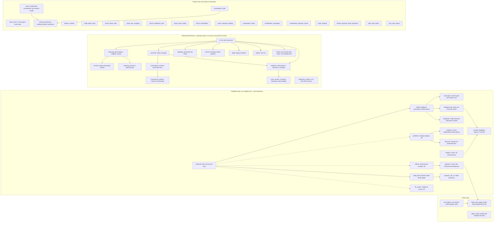

# AES canonical: system map

Question answered: which code units make up this repository, which AES part does each belong to, and what calls what?

Every unit the planning package lists in `system_model.units` is named here. Read at origin/main `c44c408`
(2026-11-11). The one-tool build (slice 1) adds the `lockstep` package to this map; it is not here yet.
Back to the [system model](SYSTEM_MODEL.md).

`records_fb` and `evidence_fb` are `scripts/learning_loop/records.py` and `evidence.py`, drawn apart from the
library's `records` and `evidence`. The unlabelled units in the last group are the claims-era scripts at
`scripts/*.py`; `~/code2` replaced claims with worktrees, and nothing in the one-tool plan uses them (open question Q10).
Dotted arrows are jobs whose timers are off (open question Q21).
