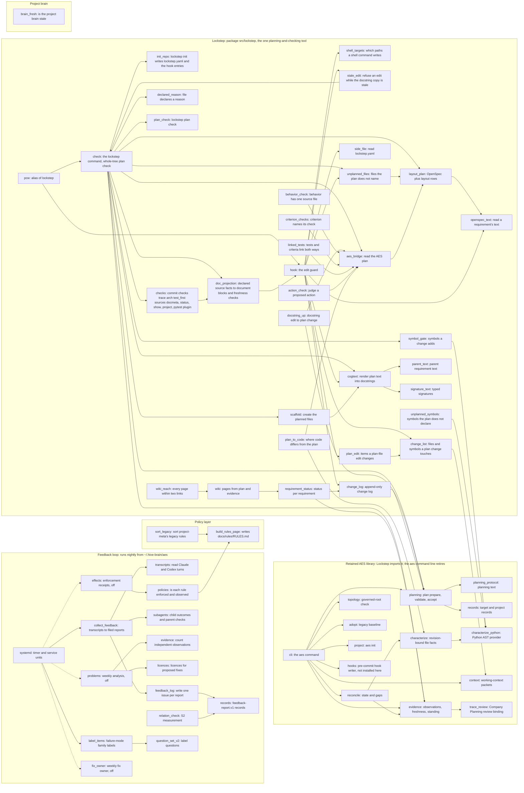

# AES canonical: system map

Question answered: which code units make up this repository, which AES part does each belong to, and what calls what?

Every unit the planning package lists in `system_model.units` is named here. Read at origin/main `0395758`
(2026-11-12), then reduced on 2026-11-12 by the cleanup that retired the claims-era scripts, `repository_context` and the agent router (docs/retired/2026-11-12.md). The `lockstep` package moved in on 2026-11-11 and 2026-11-12 (PRs #831 to #837), so Lockstep is a group
on this map; `src/pcw/__init__.py:1` is its old-name alias.
Back to the [system model](SYSTEM_MODEL.md).

The Lockstep group's `check` is `src/lockstep/check.py` and `hook` is `src/lockstep/hook.py`; its `checks` directory
holds `trace`, `arch`, `test_first`, `sources`, `docmeta`, `status`, `show`, `project`, `config`, `spec`, `markers`, `plugin` and `cli`.
The edges are the imports in `src/lockstep/*.py` (for example `src/lockstep/hook.py:107-116` imports `aes_bridge`, `change_log`,
`cogtext`, `change_list`, `openspec_text`, `shell_targets`, `side_file`, `stale_edit` and `unplanned_files`; `src/lockstep/check.py:404-413`
imports `scaffold`, `plan_check` and the `checks` directory on demand); only the main ones are drawn (`src/lockstep/hook.py:387` imports `plan_edit`, `src/lockstep/plan_edit.py:46` imports `change_list`). `records_fb` and `evidence_fb` are `scripts/learning_loop/records.py` and `evidence.py`, drawn apart from the
library's `records` and `evidence`. The claims-era scripts (`scripts/*.py`, `scripts/meta/`, `enforced_planning/` except `__init__.py`) were retired on 2026-11-12 and 2026-11-14 (open question Q10, resolved).
Dotted arrows are jobs whose timers are off (open question Q21).

Source-local documentation upkeep was added after the revision above:

| Code unit | Job | Source anchor |
| --- | --- | --- |
| `doc_projection` | Read declared Markdown metadata, Python AST interfaces and JSON/YAML evidence fields, render only their marked document blocks, and check freshness; native post-edit refresh appends daily run records. | [module contract](../../src/lockstep/doc_projection.py#L1), [projection](../../src/lockstep/doc_projection.py#L134) |
