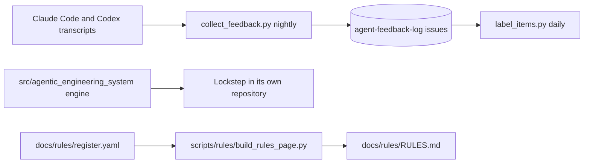

# System model

## Entry points

- `aes` runs `agentic_engineering_system.cli:main` and `aes-repo-context` runs the v0.1 `repository_context.cli:main` ([pyproject.toml:26-28](../pyproject.toml#L26-L28)).
- `aes init` governs `src/` and `tests/` by default, changed with `--governed-root` ([docs/greenfield/GETTING_STARTED.md:64-66](https://github.com/BrianMills2718/agentic-engineering-system-canonical/blob/37dc876cc3dd7f88ece46873f17a0015228af123/docs/greenfield/GETTING_STARTED.md#L64-L66)).
- `aes status` and `aes reconcile` store nothing, recompute from the target, HEAD and the observations on each run, and exit 1 only on a REFUTED criterion, an orphan or drift ([docs/greenfield/GETTING_STARTED.md:384-387](https://github.com/BrianMills2718/agentic-engineering-system-canonical/blob/37dc876cc3dd7f88ece46873f17a0015228af123/docs/greenfield/GETTING_STARTED.md#L384-L387)).
- Trace-review standing calls an external Company Planning validator configured in `~/.config/aes/trace-review.json` or `AES_TRACE_REVIEW_COMMAND`; without that configuration the requirement stays unsupported ([docs/greenfield/GETTING_STARTED.md:117-123](https://github.com/BrianMills2718/agentic-engineering-system-canonical/blob/37dc876cc3dd7f88ece46873f17a0015228af123/docs/greenfield/GETTING_STARTED.md#L117-L123)).
- The feedback jobs run `scripts/learning_loop/collect_feedback.py`, `label_items.py`, `problems.py`, `policies.py` and `fix_owner.py` from systemd ([scripts/learning_loop/systemd/feedback-collector.service:20](../scripts/learning_loop/systemd/feedback-collector.service#L20)) ([scripts/learning_loop/systemd/feedback-labels.service:17](../scripts/learning_loop/systemd/feedback-labels.service#L17)) ([scripts/learning_loop/systemd/feedback-effects.service:10-12](../scripts/learning_loop/systemd/feedback-effects.service#L10-L12)) ([scripts/learning_loop/systemd/feedback-fix-owner.service:17](../scripts/learning_loop/systemd/feedback-fix-owner.service#L17)).
- `scripts/hive/brain_fresh.py` stays here because other repositories call it by this path ([scripts/hive/README.md:7-9](../scripts/hive/README.md#L7-L9)).
- Make targets are on [run-and-deploy.md](run-and-deploy.md) ([Makefile:537-577](../Makefile#L537-L577)).

## Parts by path

- `src/agentic_engineering_system/`: the retained AES engine, pinned by Lockstep ([docs/architecture/greenfield-v0.2/README.md:15](../docs/architecture/greenfield-v0.2/README.md#L15)).
- The generated glossary maps the target records to `records.py` ([docs/planning/DOMAIN.md:14](https://github.com/BrianMills2718/agentic-engineering-system-canonical/blob/37dc876cc3dd7f88ece46873f17a0015228af123/docs/planning/DOMAIN.md#L14)), proposals to `planning.py` ([docs/planning/DOMAIN.md:25](https://github.com/BrianMills2718/agentic-engineering-system-canonical/blob/37dc876cc3dd7f88ece46873f17a0015228af123/docs/planning/DOMAIN.md#L25)), observations and freshness to `evidence.py` ([docs/planning/DOMAIN.md:29-32](https://github.com/BrianMills2718/agentic-engineering-system-canonical/blob/37dc876cc3dd7f88ece46873f17a0015228af123/docs/planning/DOMAIN.md#L29-L32)), characterization and drift to `characterize.py` ([docs/planning/DOMAIN.md:34-35](https://github.com/BrianMills2718/agentic-engineering-system-canonical/blob/37dc876cc3dd7f88ece46873f17a0015228af123/docs/planning/DOMAIN.md#L34-L35)), orphans to `topology.py` ([docs/planning/DOMAIN.md:36](https://github.com/BrianMills2718/agentic-engineering-system-canonical/blob/37dc876cc3dd7f88ece46873f17a0015228af123/docs/planning/DOMAIN.md#L36)), reconciliation to `reconcile.py` ([docs/planning/DOMAIN.md:38](https://github.com/BrianMills2718/agentic-engineering-system-canonical/blob/37dc876cc3dd7f88ece46873f17a0015228af123/docs/planning/DOMAIN.md#L38)), legacy baselines to `adopt.py` ([docs/planning/DOMAIN.md:39](https://github.com/BrianMills2718/agentic-engineering-system-canonical/blob/37dc876cc3dd7f88ece46873f17a0015228af123/docs/planning/DOMAIN.md#L39)) and working context to `context.py` ([docs/planning/DOMAIN.md:40](https://github.com/BrianMills2718/agentic-engineering-system-canonical/blob/37dc876cc3dd7f88ece46873f17a0015228af123/docs/planning/DOMAIN.md#L40)).
- `src/agentic_engineering_system/repository_context/`: the v0.1 provider, retained ([docs/decisions/0010-greenfield-v0.2-accepted.md:132](../docs/decisions/0010-greenfield-v0.2-accepted.md#L132)).
- `scripts/learning_loop/`: the feedback loop ([.project-brain/now.md:9](../.project-brain/now.md#L9)); see [feedback-loop.md](feedback-loop.md).
- `scripts/rules/` and `docs/rules/`: the rules register and its generated page ([docs/rules/RULES.md:3](../docs/rules/RULES.md#L3)).
- `enforced_planning/` and `scripts/meta/`: vendored Enforced Planning claims, sessions and worktree code, replaced in `~/code2` by `claude -w` worktrees ([docs/planning/SYSTEM_MODEL.md:101-103](../docs/planning/SYSTEM_MODEL.md#L101-L103)).
- `openspec/specs/`: the two current behavior specs ([.project-brain/now.md:3](../.project-brain/now.md#L3)) ([.project-brain/now.md:7](../.project-brain/now.md#L7)).
- Tests: `tests/greenfield`, `tests/repository_context` and `tests/learning` among others, run by `make check` over `tests/` ([Makefile:548](../Makefile#L548)) ([Makefile:577](../Makefile#L577)).
- `.aes/`: the historical engine records (target, plans, observations), read only by `aes` ([docs/decisions/0009-aes-and-lockstep-fate.md:18-19](https://github.com/BrianMills2718/code2-workspace/blob/b8b523d7ec59f54248dac2d7a780441b787d6921/docs/decisions/0009-aes-and-lockstep-fate.md#L18-L19)).
- AES does not execute typed rules: drift, staleness and similar rules are fixed Python functions ([docs/planning/SYSTEM_MODEL.md:93-96](../docs/planning/SYSTEM_MODEL.md#L93-L96)).

## Dependencies

- Python 3.11 or newer ([pyproject.toml:9](../pyproject.toml#L9)).
- Runtime: pydantic 2.13.5, PyYAML 6.0.3 and ruamel.yaml 0.18 to 0.19 ([pyproject.toml:10-14](../pyproject.toml#L10-L14)).
- Dev: pytest, mypy and pytest-xdist ([pyproject.toml:20-24](../pyproject.toml#L20-L24)).
- The version comes from setuptools-scm, and a build without Git metadata fails ([pyproject.toml:33-36](../pyproject.toml#L33-L36)).
- The feedback jobs use `llm_client` from `~/code/llm_client` through uv ([scripts/learning_loop/systemd/feedback-collector.service:18-20](../scripts/learning_loop/systemd/feedback-collector.service#L18-L20)).
- Weekly analysis reads the Observation-to-Action metamodel evaluator and runs analysis on `claude-code/sonnet` ([scripts/learning_loop/systemd/feedback-problems.service:18-22](../scripts/learning_loop/systemd/feedback-problems.service#L18-L22)).
- The jobs use project-meta tools from `~/.hive-brain/project-meta` ([scripts/learning_loop/systemd/feedback-labels.service:16](../scripts/learning_loop/systemd/feedback-labels.service#L16)).

## Storage

- Feedback outputs: `FEEDBACK_OUT=~/projects/data/feedback-collector` ([scripts/learning_loop/systemd/feedback-collector.service:17](../scripts/learning_loop/systemd/feedback-collector.service#L17)).
- The jobs run from `~/.hive-brain/aes`, a clone of AES main refreshed before every run ([scripts/learning_loop/systemd/feedback-collector.service:7-14](../scripts/learning_loop/systemd/feedback-collector.service#L7-L14)).
- Feedback reports go to the private GitHub repository `agent-feedback-log` ([scripts/learning_loop/systemd/README.md:55-56](../scripts/learning_loop/systemd/README.md#L55-L56)).

## Hooks

- Git hooks come from lefthook with the shared code2-workspace config `hooks/base.yml` ([lefthook.yml:1-7](../lefthook.yml#L1-L7)).
- The `aes` pre-commit hook has not run in this checkout since 2026-10-13, because `core.hooksPath` runs lefthook ([docs/planning/DOMAIN.md:41](https://github.com/BrianMills2718/agentic-engineering-system-canonical/blob/37dc876cc3dd7f88ece46873f17a0015228af123/docs/planning/DOMAIN.md#L41)).
- Enforced Planning's `meta-process.yaml` keeps pre-write claim checks off and plan integrity in observe mode ([meta-process.yaml:45](../meta-process.yaml#L45)) ([meta-process.yaml:55](../meta-process.yaml#L55)).

## Diagram

Older model documents: [docs/model/ODD.md:2](https://github.com/BrianMills2718/agentic-engineering-system-canonical/blob/37dc876cc3dd7f88ece46873f17a0015228af123/docs/model/ODD.md#L2) (the plan, target, evidence and reconcile loop), [docs/planning/SYSTEM_MODEL.md:2](../docs/planning/SYSTEM_MODEL.md#L2) (planning view: context, containers, record types), [docs/planning/DOMAIN.md:2](https://github.com/BrianMills2718/agentic-engineering-system-canonical/blob/37dc876cc3dd7f88ece46873f17a0015228af123/docs/planning/DOMAIN.md#L2) (domain glossary).
